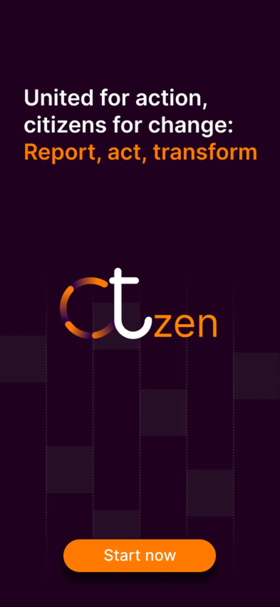
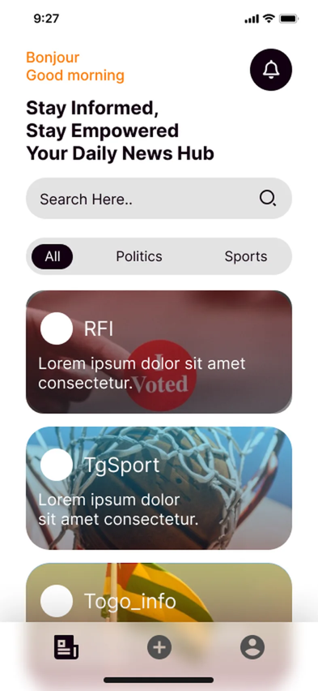
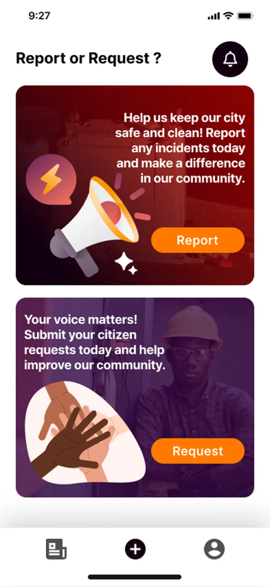
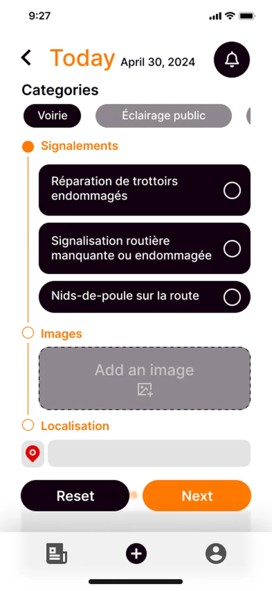
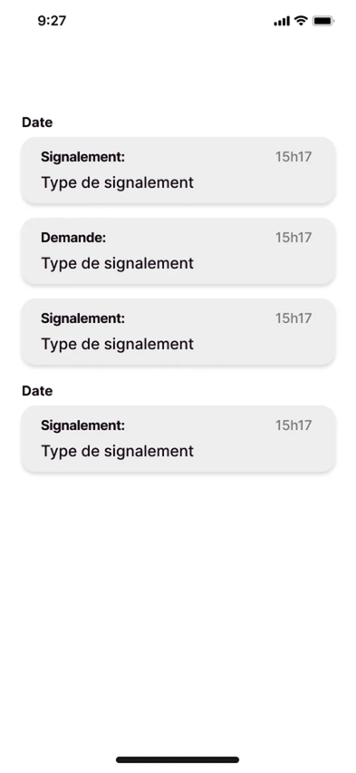
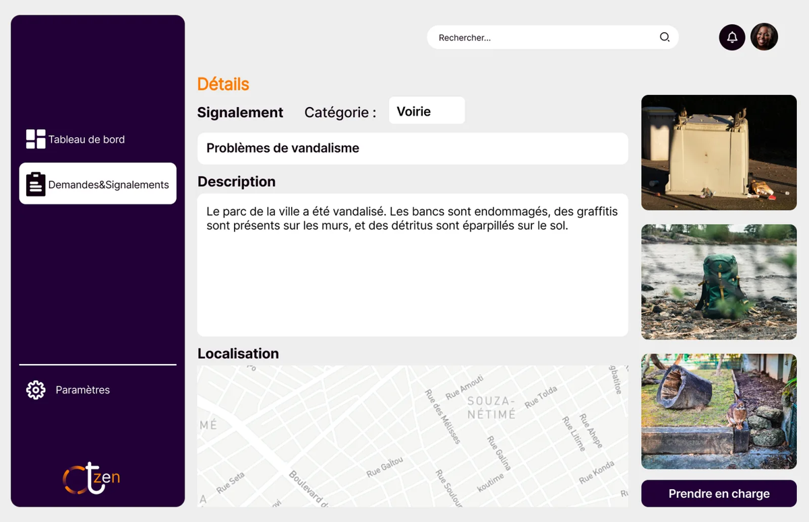

<p align="center">
  
</p>

<h1 align="center">Citizen — l'app citoyenne</h1>

<p align="center">
  Signaler un incident ou faire une demande à sa mairie, depuis son téléphone, et suivre son dossier jusqu'à sa résolution.<br>
  <em>Report an issue or make a request to your town hall from your phone, and track it until it's resolved.</em>
</p>

<p align="center">
  
  
  
  
</p>

<p align="center">
  
  
  
  
  
</p>

---

## Le contexte

Projet réalisé pendant mon stage au **Cabinet G&F (Lomé, 2024)** pour la **Mairie du Golfe 1**, et soutenu comme mémoire de licence en génie logiciel le 4 octobre 2024.

À la mairie, un simple signalement (un lampadaire en panne, un nid-de-poule…) passait par **six étapes papier** : déplacement au guichet, formulaire, dépôt au cabinet du maire, affectation à un service, visite de terrain, rapport. Aucun suivi n'était possible pour le citoyen.

**Citizen** remplace ce circuit par un dossier numérique unique :

- 📱 une **application mobile** (ce dépôt) pour les citoyens ;
- 🖥️ un **back-office web** pour les agents municipaux ;
- 🔐 une **API REST Spring Boot** sécurisée par JWT, avec une base MySQL.

> 📖 Étude de cas complète (problème, démarche, maquettes, architecture) : voir mon portfolio.

## Fonctionnalités

| | |
|---|---|
| 🔑 **Authentification** | Inscription et connexion par email, Google ou Facebook |
| 📰 **Accueil** | Actualités de la commune, filtrables par thème |
| 📍 **Signalement** | Catégorie (voirie, éclairage public, propreté…), photo, géolocalisation sur carte |
| 📝 **Demande** | Formulaire guidé pour les demandes administratives |
| 🔔 **Notifications** | Suivi du statut de chaque dossier : à prendre, en cours, résolu |
| 🕓 **Historique** | Tous les dossiers envoyés, datés |
| 👤 **Profil** | Compte, confidentialité, notifications, aide |
| 🌍 **Multilingue** | Français et anglais (i18next) |

## Le back-office (agents municipaux)

<p align="center">
  
</p>
<p align="center">
  
</p>

## Stack technique

- **Mobile :** Expo 51, React Native 0.74, TypeScript, Expo Router (navigation par fichiers)
- **Cartes et localisation :** `react-native-maps`, `expo-location`
- **Médias :** `expo-image-picker`
- **Notifications :** `expo-notifications`
- **Traductions :** `i18next`, `react-i18next`
- **Appels API :** `axios`, `fetch`, session stockée avec AsyncStorage
- **Backend (dépôt séparé) :** Java, Spring Boot, Spring Security, JWT, BCrypt, MySQL

## Structure

```
app/
├── (auth)/          # Connexion, inscription, chargement
├── (tabs)/          # Accueil, ajout, profil
├── notifications/   # Liste et détail des notifications
├── ProfileSreen/    # Profil, confidentialité, historique, aide
├── Report.tsx       # Formulaire de signalement
└── Request.tsx      # Formulaire de demande
components/          # Catégories, actualités, modales, UI
context/auth.tsx     # Gestion de la session utilisateur
translation/         # fr.json, en.json
```

## Lancer le projet

```bash
npm install
npx expo start
```

Puis ouvrez l'application dans **Expo Go**, un émulateur Android ou un simulateur iOS.

> ⚠️ L'application appelle l'API Spring Boot à une adresse locale (`http://<IP>:2030/api/...`). Remplacez cette adresse par celle de votre serveur dans `app/(auth)/login.tsx`, `app/(auth)/signup.tsx`, `app/Report.tsx` et `app/Request.tsx`.

## Auteur

**Erminio Dorkenoo** — conception (Figma), développement mobile et web.
Étudiant en MSc Intelligence Artificielle à l'ECE Paris.

[LinkedIn](https://www.linkedin.com/in/erminio-dorkenoo-21458a232) · [erminiodorkenoo@gmail.com](mailto:erminiodorkenoo@gmail.com)
